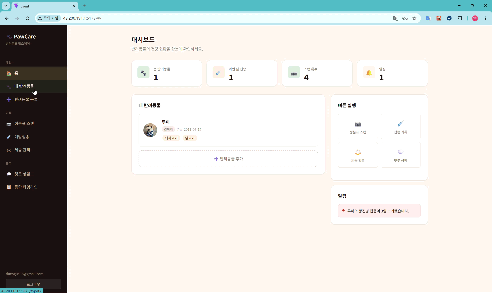

# Paw Care

> 사진 한 장으로 기록하고, 쌓인 기록으로 상담받는 반려동물 헬스케어
> 강아지·고양이 보호자가 일상 데이터(체중·음식·접종)를 기록해서
> 병원 가기 전에 미리 위험을 알아챌 수 있게 도와주는 **웹 서비스**입니다.

**팀**: 김태현(총괄) · 김기연 · 장윤서 · 김찬영
**개발 기간**: 6주

* * *

## Screenshot



* * *

## 접속

**[PawCare](http://43.200.191.1:5173/)**

```
http://43.200.191.1:5173/
```

회원가입 후 반려동물을 등록하면 모든 기능을 사용할 수 있습니다.

* * *

## 프로젝트 한 줄 요약

- **무엇을**: 반려동물 헬스케어 웹 (체중·위험음식·예방접종 통합 관리 + 챗봇 상담)
- **왜**: "병원을 최대한 적게 가기 위해 사전에 대비"
- **어떻게**: 영수증·성분표 사진을 올리면 OCR이 자동 분류·기록하고, 기록이 쌓이면 챗봇이 그 데이터를 근거로 답합니다.

* * *

## 해결하려는 문제

- 체중·접종·먹이 기록을 각각 따로 입력해야 해서 꾸준히 기록하기 어렵습니다.
- 사료 성분표의 위험 성분이나 우리 아이의 알러지 성분을 매번 직접 확인하기 어렵습니다.
- 접종 일정이 여러 차수에 걸쳐 있어 다음 접종일을 놓치기 쉽습니다.

* * *

## 주요 기능

| 영역 | 내용 |
|---|---|
| 회원·반려동물 | 이메일 가입/로그인(httpOnly 쿠키 인증), 한 계정에서 여러 마리 등록·전환, 프로필 사진 업로드 |
| OCR 자동 기록 | 영수증/성분표 사진 업로드 → 문서 자동 분류 → 사용자 확인 후 저장 |
| 성분표 분석 | 위험 음식 DB(ASPCA 기준) 매칭 + 반려동물 알러지 매칭 → 화면 즉시 경고 |
| 체중 관리 | 체중 기록·그래프, 직전 대비 ±10% 이상 변동 시 급변 판정 |
| 예방접종 | 백신 마스터 기반 이력 관리, 다음 접종일 계산, D-7 · D-1 · D-day 이메일 알림 |
| 통합 타임라인 | 체중·접종·성분표 스캔을 시간순 한 화면으로 결합 |
| 챗봇 | OpenAI + 펫 단위 DB 컨텍스트(프로필·체중 추이·접종·스캔)로 맞춤 답변, 진단·처방은 하지 않음 |

* * *

## 주요 문서

| 문서 | 무슨 내용 | 언제 보면 되나 |
|---|---|---|
| **[`RESEARCH.md`](RESEARCH.md)** | 왜 이 기능을 만드는지 배경 조사 | 처음에 프로젝트 이해할 때 |
| **[`PLAN.md`](PLAN.md)** | 시스템 설계, 화면 구성, DB 구조, 기능별 상세 명세 | 구현 근거를 확인할 때 |
| **[`function.md`](function.md)** | 팀원별 담당 기능과 자료조사 범위 | 역할 분담을 확인할 때 |
| **[`workflow.md`](workflow.md)** | 사용자 시점 워크플로 | 사용 흐름을 볼 때 |
| **[`server/README.md`](server/README.md)** | ERD, API 명세 | API를 연동할 때 |
| **[`client/README.md`](client/README.md)** | 프론트엔드 실행법, 폴더 구조 | 화면 개발할 때 |
| **[`/research`](research/)** | 팀원별 자료조사(백신·위험음식·인증 등) | 데이터 출처를 확인할 때 |
| **[`/presentation`](presentation/)** | 발표 자료·대본, 기술 차별점 | 발표 준비할 때 |

* * *

## 기술 스택

| 분야 | 기술 |
|---|---|
| 프론트엔드 |     |
| 백엔드 |    |
| 데이터베이스 |  |
| 스토리지 |  |
| 외부 API |   |
| 배포 |  |

* * *

## 팀원 역할

| 이름 | 역할 | 담당 |
|---|---|---|
| 김태현 | 총괄 | 회원가입/로그인, 반려동물 등록, 챗봇 |
| 김기연 | 개발 | 체중 관리, 통합 타임라인·대시보드 |
| 장윤서 | 개발 | OCR 변환, 위험 음식·알러지 매칭 |
| 김찬영 | 개발 | 예방접종 관리, DB(RDS)·배포 환경 |

* * *

## 설계 포인트

- **OCR은 자동 저장하지 않습니다.** 오인식이 잘못된 의료 기록으로 남지 않도록 항상 사용자 확인 후 저장합니다.
- **AI 진단을 하지 않습니다.** 챗봇은 일반 정보만 제공하고, 답변마다 면책 고지와 응급 시 병원 방문 안내를 함께 보여줍니다.
- **펫 단위로 데이터를 격리합니다.** 모든 기록은 `pet_id`로 분리하고, 모든 API에서 사용자-펫 소유권을 검증합니다.
- **챗봇 컨텍스트를 감사할 수 있습니다.** 응답 시점에 주입한 컨텍스트를 `ChatLog.context_snapshot_json`에 저장합니다.
- **의료 데이터는 1차 출처로 검증합니다.** 위험 음식(ASPCA), 백신(KASA·농림축산검역본부)은 2곳 이상 교차 검증된 항목만 시드로 등록합니다.
- **개인정보를 최소화합니다.** 집주소는 수집하지 않습니다.

* * *

## 폴더 구조

```
petManagement/
├─ client/                 # React 프론트엔드
│  └─ src/
│     ├─ components/       # 기능별 패널 (Ocr / Weight / Vaccinations / Timeline / Chatbot)
│     ├─ api.ts            # 백엔드 API 클라이언트
│     └─ App.tsx           # 라우팅 · 레이아웃 · 인증 상태
├─ server/                 # Express 백엔드
│  ├─ migrations/          # PostgreSQL 스키마·시드 SQL
│  └─ src/modules/         # auth · pets · weights · vaccinations · ocr
│                          # ingredient-scans · timeline · chatbot · notifications
├─ research/               # 팀원별 자료조사
├─ presentation/           # 발표 자료
├─ PLAN.md  RESEARCH.md  function.md  workflow.md
└─ erd.png                 # ERD
```

* * *

## 실행 방법

```bash
# 백엔드
cd server
npm install
cp .env.example .env     # 값 채우기
npm run migrate          # DB 스키마·시드 적용
npm run dev              # http://localhost:4000

# 프론트엔드
cd client
npm install
npm run dev              # http://localhost:5173
```

`server/.env` 필수 값: `DATABASE_URL`, `JWT_ACCESS_SECRET`, `CLOVA_OCR_INVOKE_URL`, `CLOVA_OCR_SECRET`, `OPENAI_API_KEY`
선택 값: `SMTP_*`(이메일 알림), `AWS_REGION` · `AWS_S3_BUCKET`(프로필 사진 업로드)

> 시크릿 키는 저장소에 올리지 않습니다. `.env`는 `.gitignore`에 포함되어 있습니다.
